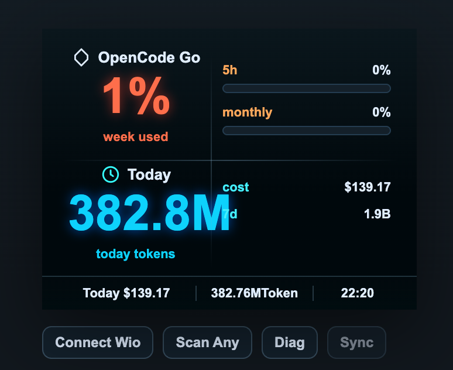

# Wio Terminal AI Token Dashboard

> Real-time **OpenCode Go** usage dashboard on **Wio Terminal** (320×240), synced via **BLE** from a local Python server.
>
> 在 **Wio Terminal**（320×240 横屏）上实时显示 **OpenCode Go** 用量额度，由本地 Python 服务端通过 **蓝牙（BLE）** 推送。



**Languages:** [English](#english) · [中文](#中文)

---

## 🚀 本机使用指南（当前部署）

> 本机（macOS）已配置完成：**固件已刷入**、虚拟环境已建、一键脚本已备好。
> 当前屏幕显示内容：**OpenCode Go 额度**（5h 滚动 / 本周 / 本月已用百分比）+ **今日用量**（tokens / 成本），额度来自官方 Go usage API（`OPENCODE_GO_API_KEY`），今日用量来自本地会话日志。
> 下面内容与本文档其他章节（描述旧版 Claude/Codex 5h/7d 额度）不同，**以本节为准**。

### 日常使用

在项目目录 `~/temp/wio-terminal-ai-quota-dashboard` 下：

```bash
./dashboard.sh start      # 启动（BLE 服务器 + 数据同步，后台运行）
./dashboard.sh stop       # 停止
./dashboard.sh status     # 看状态和最近日志
./dashboard.sh web        # 打开网页预览
```

### 启动前确认

1. **Wio Terminal**：插上数据线，电源开关拨到 ON，屏幕亮起（会显示上次的数据）
2. **电脑与 Wio 距离近**（BLE 范围几米内）
3. 启动后约 15 秒内屏幕开始刷新

### 套餐额度变旧了怎么办

套餐额度来自官方 OpenCode Go usage API，需要环境变量 `OPENCODE_GO_API_KEY`。启动前确认已导出：

```bash
export OPENCODE_GO_API_KEY=oc_你的Go订阅Key
./dashboard.sh start
```

- **Key 过期**时接口返回 `api_key_expired`，屏幕保留上次的值不更新。到 [OpenCode Console](https://opencode.ai/console) 重新生成 Key 并更新环境变量，再重启。
- 也可把 export 写进 `~/.zshrc` 避免每次手动设置。

### 网页版

浏览器打开 `http://127.0.0.1:8765/preview.html`，或 `./dashboard.sh web`。

### 首次从头安装（重装系统 / 新电脑时）

```bash
cd ~/temp/wio-terminal-ai-quota-dashboard
python3 -m venv .venv
./.venv/bin/pip install -r requirements.txt
./dashboard.sh start
```

**固件已刷好，平时不需要重刷。** 只有屏幕黑屏且无任何 UI 时才需要重刷固件（步骤较复杂，见下方「硬件与固件」章节，或参照 SenseCraft 官方文档）。

---

---

<a id="english"></a>

## English

### Overview


Display **5-hour rolling**, **weekly** and **monthly** OpenCode Go quota usage (percentage + reset time), plus today's token consumption and estimated cost — all on a Wio Terminal screen.

Data is fetched from the official Go usage API by a Python server on your PC and pushed to the device over Bluetooth. No manual quota entry required.

### Table of Contents

- [Features](#features)
- [Project Structure](#project-structure)
- [Data Flow](#data-flow)
- [Quick Start](#quick-start)
- [Hardware & Firmware](#hardware--firmware)
- [Server](#server)
- [Auto Sync](#auto-sync)
- [Cost Estimation](#cost-estimation)
- [Data Format](#data-format)
- [HTTP API](#http-api)
- [BLE Parameters](#ble-parameters)
- [Process Management](#process-management)
- [FAQ](#faq)
- [More Docs](#more-docs)

### Features

| Feature | Description |
| --- | --- |
| Quota bars | **5h rolling / weekly / monthly** OpenCode Go usage with reset time |
| Auto fetch | Pull real quotas from the official Go usage API (`OPENCODE_GO_API_KEY`) |
| Token stats | Count **today / last 7 days** tokens from local session logs |
| Cost estimate | Convert tokens to **Today** cost using model API pricing |
| BLE push | Auto-push to Wio Terminal with partial screen refresh |
| Web preview | Included `preview.html` page |
| Auto loop | Fetch → write → push on a timer |

### Project Structure

```text
wio-terminal-ai-quota-dashboard/
├── arduino/ai_quota_dashboard/ai_quota_dashboard.ino   # Arduino IDE firmware
├── src/main.cpp                                        # PlatformIO firmware
├── platformio.ini                                      # PlatformIO config
├── preview.html                                        # Web preview
├── server.py                                           # Python server (HTTP + BLE)
├── start_auto_ble.py                                   # Server launcher (bleak check)
├── requirements.txt                                    # Python dependencies
├── data/quota.json                                     # Dashboard data file
├── tools/
│   ├── codex_usage.py                                  # Fetch Codex quota (legacy, unused)
│   ├── claude_usage.py                                 # Fetch Claude quota (legacy, unused)
│   ├── token_usage.py                                  # Count today/7d tokens
│   ├── auto_sync.py                                    # Orchestrator: fetch → write → push
│   ├── run-server-auto-ble.ps1                         # One-click start server.py --ble
│   └── send-test-ble.ps1                               # Direct BLE test
├── README.md                                           # This file
└── USER.md                                             # User guide
```

### Data Flow

```text
OpenCode Go account              Local logs (~/.codex, ~/.claude)
   │ GET /inference/go/v1/usage      │ token_count / message.usage
   ▼  (Bearer $OPENCODE_GO_API_KEY)  ▼
auto_sync.fetch_plan()        token_usage.py (today/7d tokens)
 (rolling/weekly/monthly %)
   └───────────────────┬────────────┘
                       ▼
          tools/auto_sync.py  (every 60s)
          ├ Estimate Today cost (API pricing)
          └ Write data/quota.json + POST /api/quota
                       ▼
             server.py --ble  (daemon)
                   └ POST → immediate BLE push; fallback every 15s
                                ▼  Bluetooth
                          Wio Terminal screen
```

| Data | Source | Cost |
| --- | --- | --- |
| OpenCode Go 5h / weekly / monthly %, reset | Official `GET /inference/go/v1/usage` | Zero tokens |
| Today / 7d token count | Local session JSONL logs | Local only |
| Today cost (USD) | Tokens × model API pricing | Estimated equivalent |

### Quick Start

**1. Install dependencies**

```powershell
pip install -r requirements.txt
```

**2. Flash firmware**

Open `arduino/ai_quota_dashboard/ai_quota_dashboard.ino` in **Arduino IDE**, select **Seeed Wio Terminal**, install libraries, and upload.

Or use **PlatformIO**:

```powershell
pio run -t upload
```

**3. Ensure Codex uses official provider**

`~/.codex/config.toml` must not point to a third-party proxy:

```toml
model = "gpt-5.5"
model_reasoning_effort = "high"
disable_response_storage = true
```

> Remove any `model_provider = "custom"` block pointing to a proxy.

**4. Start services (two terminals)**

```powershell
# Terminal 1: server
py -u server.py --ble --ble-interval 15

# Terminal 2: auto sync loop
py -u tools\auto_sync.py --interval 60
```

The device screen shows live quotas, refreshed every 60 seconds.

Web preview: http://127.0.0.1:8765/preview.html

### Hardware & Firmware

**Device:** Seeed **Wio Terminal** (320×240 LCD)

**Required libraries (Seeed-maintained versions only):**

| Library | Purpose |
| --- | --- |
| `Seeed_Arduino_LCD` / `Seeed_GFX` | Display (`TFT_eSPI.h`, Wio pin config included) |
| `Seeed_Arduino_FS` | File system |
| `Seeed_Arduino_rpcUnified` | RPC unified layer |
| `Seeed_Arduino_rpcBLE` | BLE communication |
| `ArduinoJson` | JSON parsing |

> **Warning:** Do not replace `Seeed_Arduino_LCD` with Bodmer's original `TFT_eSPI` — it causes white screen or wrong dimensions.

### Server

```powershell
py -u server.py --ble --ble-interval 15
```

| Flag | Description |
| --- | --- |
| `--ble` | Enable Bluetooth auto-push |
| `--ble-interval` | Push interval in seconds (default 15) |
| `--ble-name` | Target device name (default `Wio AI Quota`) |

Custom port:

```powershell
py server.py 8876 --ble
```

Alternative launchers:

```powershell
py start_auto_ble.py
powershell -ExecutionPolicy Bypass -File .\tools\run-server-auto-ble.ps1
```

### Auto Sync

```powershell
# OpenCode Go quota (needs OPENCODE_GO_API_KEY in the environment)
$env:OPENCODE_GO_API_KEY = "oc_sk_..."

# Token stats
py tools\token_usage.py
py tools\token_usage.py --json

# Auto sync
py tools\auto_sync.py --once
py tools\auto_sync.py --interval 60
```

**OpenCode Go notes:** `auto_sync.fetch_plan()` calls
`GET https://opencode.ai/inference/go/v1/usage` with `Authorization: Bearer $OPENCODE_GO_API_KEY`.
The response carries `rolling` (5-hour) / `weekly` / `monthly` windows, each with `status`, `percent` (0–100)
and `resetsAt`.

- A **403 `EntitlementError`** means the key's workspace has no active Go subscription
- A **401 `api_key_expired`** means the key itself is expired — create a new one in the [Console](https://opencode.ai/console)
- On any failure `auto_sync` keeps the previous snapshot, so the device never shows blanks
- `codex_usage.py` / `claude_usage.py` remain in `tools/` but are no longer called

### Cost Estimation

`PRICING` in `tools/auto_sync.py` (current: `gpt-5.5` standard context):

| Item | Price / 1M tokens |
| --- | --- |
| Input | $5.00 |
| Cached input | $0.50 |
| Output | $30.00 |

```text
Today = (input - cached) × $5/1M + cached × $0.5/1M + output × $30/1M
```

> This is an **equivalent API cost estimate**, not actual subscription billing.

### Data Format

File: `data/quota.json`

```json
{
  "updatedAt": "15:07",
  "footer": {
    "cost": "$105.43",
    "tokens": "284.8MToken",
    "time": "15:07"
  },
  "plan": {
    "rolling": { "pct": 0, "resetAt": "2026-10-18T11:51:57.000Z" },
    "weekly":  { "pct": 0, "resetAt": "2026-10-19T00:00:00.000Z" },
    "monthly": { "pct": 0, "resetAt": "2026-11-18T05:52:53.000Z" }
  },
  "today": {
    "tokens": "284.8MToken",
    "tokensShort": "284.8M",
    "cost": "$105.43",
    "weekTokens": "1.9BToken",
    "weekShort": "1.9B"
  }
}
```

`plan` is the raw OpenCode Go usage response (`GET https://opencode.ai/inference/go/v1/usage`), with each
window flattened to `pct` / `resetAt`. `today` is derived from the local session logs.

| Field | Meaning |
| --- | --- |
| `updatedAt` | Last update time |
| `footer.cost` | Bottom-left: today's cost |
| `footer.tokens` | Bottom-center: today's total tokens |
| `footer.time` | Bottom-right: time |
| `plan.rolling` | 5-hour rolling window (Go `usage.rolling`) |
| `plan.weekly` | Weekly allowance (Go `usage.weekly`) |
| `plan.monthly` | Monthly allowance (Go `usage.monthly`) |
| `pct` / `resetAt` | Used % (0–100) / window reset time |
| `today.*` | Today's tokens, cost and 7-day total from local logs |

Upstream response shape (before flattening):

```json
{
  "usage": {
    "rolling": { "status": "ok", "percent": 0, "resetsAt": "2026-10-18T11:51:57.000Z" },
    "weekly":  { "status": "ok", "percent": 0, "resetsAt": "2026-10-19T00:00:00.000Z" },
    "monthly": { "status": "ok", "percent": 0, "resetsAt": "2026-11-18T05:52:53.000Z" }
  }
}
```

> `status` is `ok` or `rate-limited`; it is not shown on the device.

### HTTP API

| Method | Path | Description |
| --- | --- | --- |
| `GET` | `/preview.html` | Web preview |
| `GET` | `/api/quota` | Read `data/quota.json` |
| `POST` | `/api/quota` | Write `data/quota.json` and trigger BLE push |
| `GET` | `/api/ble/status` | BLE sync status |
| `POST` | `/api/ble/sync` | Trigger immediate BLE send |

### BLE Parameters

| Item | Value |
| --- | --- |
| Device name | `Wio AI Quota` |
| Service UUID | `6e400001-b5a3-f393-e0a9-e50e24dcca9e` |
| RX UUID | `6e400002-b5a3-f393-e0a9-e50e24dcca9e` |
| TX UUID | `6e400003-b5a3-f393-e0a9-e50e24dcca9e` |

> Do not pair via Windows "Add Bluetooth device". Connect via server, web `Connect Wio`, or `send-test-ble.ps1`.

```powershell
.\tools\send-test-ble.ps1
.\tools\send-test-ble.ps1 -ListOnly
.\tools\send-test-ble.ps1 -ListAllBle
```

### Process Management

`Stop-Process -Id <PID>` may only kill the `py` launcher; orphaned `python.exe` children cause duplicate pushes and flickering values.

```powershell
# List
Get-CimInstance Win32_Process -Filter "Name='python.exe'" |
  Where-Object { $_.CommandLine -match 'server\.py|auto_sync\.py' } |
  Select-Object ProcessId, CommandLine

# Stop all
Get-CimInstance Win32_Process -Filter "Name='python.exe'" |
  Where-Object { $_.CommandLine -match 'server\.py|auto_sync\.py' } |
  ForEach-Object { Stop-Process -Id $_.ProcessId -Force }
```

Only **1 server + 1 auto_sync** should be running.

### FAQ

| Symptom | Cause / Fix |
| --- | --- |
| `401 api_key_expired` | Go key expired — create a new one in the [Console](https://opencode.ai/console) and update `OPENCODE_GO_API_KEY` |
| `403 EntitlementError` | The key's workspace has no active Go subscription |
| `OPENCODE_GO_API_KEY not set` | Export the variable before starting `auto_sync` |
| Go quota frozen at old numbers | Last fetch failed — check the `[plan] ...` line in the auto_sync log |
| Values flicker between two numbers | Orphaned processes — clean up as above |
| `[BLE] synced` but device unchanged | Check serial (115200) for `JSON_OK dashboard updated` |
| bleak not found | `pip install -r requirements.txt` |
| Device not found | Device on, broadcasting `Wio AI Quota`, Bluetooth enabled |
| Arduino missing libs | Install Seeed libraries listed above |

### More Docs

- [USER.md](./USER.md) — Quick start and daily usage guide

---

<a id="中文"></a>

## 中文

### 项目简介


在 Wio Terminal 屏幕上实时显示 OpenCode Go 的 **5 小时滚动**、**本周**和**本月**额度（已用百分比 + 重置时间），以及今日 token 消耗和折算成本。

数据由电脑本地的 Python 服务端从官方 Go usage API 自动获取，并通过蓝牙推送到设备，无需手动填写额度。

### 目录

- [功能特性](#功能特性-1)
- [项目结构](#项目结构-1)
- [数据链路](#数据链路-1)
- [快速开始](#快速开始-1)
- [硬件与固件](#硬件与固件-1)
- [服务端](#服务端-1)
- [真实额度自动同步](#真实额度自动同步)
- [成本折算](#成本折算)
- [数据格式](#数据格式-1)
- [HTTP 接口](#http-接口)
- [BLE 参数](#ble-参数)
- [进程管理](#进程管理-1)
- [常见问题](#常见问题)
- [更多文档](#更多文档)

### 功能特性

| 功能 | 说明 |
| --- | --- |
| 额度进度条 | 显示 OpenCode Go 的 **5h 滚动 / 本周 / 本月**额度进度与重置时间 |
| 自动拉取 | 从官方 Go usage API 拉取真实额度（需 `OPENCODE_GO_API_KEY`） |
| Token 统计 | 按本地会话日志统计 **今日 / 近 7 天** token 用量 |
| 成本折算 | 按模型 API 报价折算 **Today** 成本 |
| BLE 推送 | 通过蓝牙自动推送到 Wio Terminal，屏幕局部刷新、低闪烁 |
| 网页预览 | 附带 `preview.html` 网页预览页 |
| 定时循环 | 拉取 → 写数据 → 推送，全自动 |

### 项目结构

```text
wio-terminal-ai-quota-dashboard/
├── arduino/ai_quota_dashboard/ai_quota_dashboard.ino   # Arduino IDE 固件
├── src/main.cpp                                        # PlatformIO 固件
├── platformio.ini                                      # PlatformIO 配置
├── preview.html                                        # 网页预览
├── server.py                                           # Python 服务端（HTTP API + BLE 自动推送）
├── start_auto_ble.py                                   # 服务端启动器（带 bleak 检查）
├── requirements.txt                                    # Python 依赖
├── data/quota.json                                     # 仪表盘数据文件
├── tools/
│   ├── codex_usage.py                                  # 拉取 Codex 真实额度（旧版，已不使用）
│   ├── claude_usage.py                                 # 拉取 Claude 真实额度（旧版，已不使用）
│   ├── token_usage.py                                  # 统计今日/近 7 天 token
│   ├── auto_sync.py                                    # 编排：拉取 → 折算 → 写 JSON → 推送
│   ├── run-server-auto-ble.ps1                         # 一键启动 server.py --ble
│   └── send-test-ble.ps1                               # BLE 直发测试
├── README.md                                           # 项目总览（本文档）
└── USER.md                                             # 使用教程
```

### 数据链路

```text
OpenCode Go 账号              本地会话日志 (~/.codex, ~/.claude)
   │ GET /inference/go/v1/usage   │ token_count / message.usage
   ▼  (Bearer $OPENCODE_GO_API_KEY) ▼
auto_sync.fetch_plan()      token_usage.py (今日/7天 token)
 (rolling/weekly/monthly %)
   └──────────────────┬───────────┘
                      ▼
         tools/auto_sync.py  (每 60s)
         ├ 折算 Today 成本（按模型报价）
         └ 写 data/quota.json + POST /api/quota
                      ▼
            server.py --ble  (常驻)
         └ 收到 POST → 立即 BLE 推送；另每 15s 兜底推
                      ▼  蓝牙
                Wio Terminal 屏幕
```

| 数据 | 来源 | 成本 |
| --- | --- | --- |
| OpenCode Go 5h / 本周 / 本月 百分比、重置 | 官方 `GET /inference/go/v1/usage` | 零 token |
| 今日 / 近 7 天 token 数 | 本地会话日志 JSONL 累加 | 纯本地 |
| Today 成本（美金） | token 数 × 模型 API 报价 | 等值折算 |

### 快速开始

**1. 安装依赖**

```powershell
pip install -r requirements.txt
```

**2. 烧录固件**

用 **Arduino IDE** 打开 `arduino/ai_quota_dashboard/ai_quota_dashboard.ino`，开发板选 **Seeed Wio Terminal**，装齐依赖库后上传。

或使用 **PlatformIO**：

```powershell
pio run -t upload
```

**3. 确认 Codex 官方直连**

`~/.codex/config.toml` 不能指向第三方中转。应使用默认 provider：

```toml
model = "gpt-5.5"
model_reasoning_effort = "high"
disable_response_storage = true
```

> 若有 `model_provider = "custom"` 指向中转地址，请删除。

**4. 启动服务（两个终端）**

```powershell
# 终端 1：服务器
py -u server.py --ble --ble-interval 15

# 终端 2：自动循环
py -u tools\auto_sync.py --interval 60
```

设备屏幕即显示真实额度，每 60 秒自动刷新。

网页预览：http://127.0.0.1:8765/preview.html

### 硬件与固件

**设备：** Seeed **Wio Terminal**（320×240 LCD）

**依赖库（必须使用 Seeed 维护版）：**

| 库 | 用途 |
| --- | --- |
| `Seeed_Arduino_LCD` / `Seeed_GFX` | 屏幕（提供 `TFT_eSPI.h`，已含 Wio 引脚配置） |
| `Seeed_Arduino_FS` | 文件系统 |
| `Seeed_Arduino_rpcUnified` | RPC 统一层 |
| `Seeed_Arduino_rpcBLE` | BLE 通信 |
| `ArduinoJson` | JSON 解析 |

> **注意：** 不要用 Bodmer 原版 `TFT_eSPI` 替代 `Seeed_Arduino_LCD`，否则会白屏或尺寸错乱。

### 服务端

```powershell
py -u server.py --ble --ble-interval 15
```

| 参数 | 说明 |
| --- | --- |
| `--ble` | 启用蓝牙自动推送 |
| `--ble-interval` | 推送间隔（秒，默认 15） |
| `--ble-name` | 目标设备名（默认 `Wio AI Quota`） |

指定端口：

```powershell
py server.py 8876 --ble
```

其他启动方式：

```powershell
py start_auto_ble.py
powershell -ExecutionPolicy Bypass -File .\tools\run-server-auto-ble.ps1
```

### 真实额度自动同步

```powershell
# OpenCode Go 额度（需在环境变量中提供 OPENCODE_GO_API_KEY）
$env:OPENCODE_GO_API_KEY = "oc_sk_..."

# Token 统计
py tools\token_usage.py
py tools\token_usage.py --json

# 自动同步
py tools\auto_sync.py --once
py tools\auto_sync.py --interval 60
```

**OpenCode Go 额度说明：** `auto_sync.fetch_plan()` 调用
`GET https://opencode.ai/inference/go/v1/usage`，请求头 `Authorization: Bearer $OPENCODE_GO_API_KEY`。
响应对应 `rolling`（5 小时）/ `weekly` / `monthly` 三个窗口，每个含 `status`、`percent`（0–100）、`resetsAt`。

- 返回 **403 `EntitlementError`** 表示该 key 所在工作区没有生效中的 Go 订阅
- 返回 **401 `api_key_expired`** 表示 key 本身已过期，需到 [Console](https://opencode.ai/console) 重新生成
- 任何失败时 `auto_sync` 保留上次快照，屏幕不会空白
- `codex_usage.py` / `claude_usage.py` 仍留在 `tools/`，但已不再被调用

### 成本折算

`tools/auto_sync.py` 顶部 `PRICING` 定义每 token 单价（当前按 `gpt-5.5` 标准短上下文）：

| 项 | 单价 / 1M token |
| --- | --- |
| 输入 | $5.00 |
| 缓存输入 | $0.50 |
| 输出 | $30.00 |

```text
Today = (input - cached) × $5/1M + cached × $0.5/1M + output × $30/1M
```

> 这是按 API 标准报价的**等值成本**，订阅制账号并非按 token 真实扣费。

### 数据格式

文件路径：`data/quota.json`

```json
{
  "updatedAt": "15:07",
  "footer": {
    "cost": "$105.43",
    "tokens": "284.8MToken",
    "time": "15:07"
  },
  "plan": {
    "rolling": { "pct": 0, "resetAt": "2026-10-18T11:51:57.000Z" },
    "weekly":  { "pct": 0, "resetAt": "2026-10-19T00:00:00.000Z" },
    "monthly": { "pct": 0, "resetAt": "2026-11-18T05:52:53.000Z" }
  },
  "today": {
    "tokens": "284.8MToken",
    "tokensShort": "284.8M",
    "cost": "$105.43",
    "weekTokens": "1.9BToken",
    "weekShort": "1.9B"
  }
}
```

`plan` 直接来自官方 OpenCode Go usage 接口（`GET https://opencode.ai/inference/go/v1/usage`），每个窗口摊平成
`pct` / `resetAt`。`today` 由本地会话日志算出。

| 字段 | 含义 |
| --- | --- |
| `updatedAt` | 数据更新时间 |
| `footer.cost` | 底部左：今日成本（Today） |
| `footer.tokens` | 底部中：今日 token 总量 |
| `footer.time` | 底部右：时间 |
| `plan.rolling` | 5 小时滚动窗口（Go `usage.rolling`） |
| `plan.weekly` | 本周额度（Go `usage.weekly`） |
| `plan.monthly` | 本月额度（Go `usage.monthly`） |
| `pct` / `resetAt` | 已用百分比（0–100） / 窗口重置时间 |
| `today.*` | 本地日志算出的今日 token、成本与近 7 天总量 |

上游原始响应（摊平前）：

```json
{
  "usage": {
    "rolling": { "status": "ok", "percent": 0, "resetsAt": "2026-10-18T11:51:57.000Z" },
    "weekly":  { "status": "ok", "percent": 0, "resetsAt": "2026-10-19T00:00:00.000Z" },
    "monthly": { "status": "ok", "percent": 0, "resetsAt": "2026-11-18T05:52:53.000Z" }
  }
}
```

> `status` 为 `ok` 或 `rate-limited`，设备上不显示。

### HTTP 接口

| 方法 | 路径 | 说明 |
| --- | --- | --- |
| `GET` | `/preview.html` | 网页预览 |
| `GET` | `/api/quota` | 读取 `data/quota.json` |
| `POST` | `/api/quota` | 写入 `data/quota.json` 并触发 BLE 推送 |
| `GET` | `/api/ble/status` | 查看 BLE 同步状态 |
| `POST` | `/api/ble/sync` | 立即触发一次 BLE 发送 |

### BLE 参数

| 项 | 值 |
| --- | --- |
| Device name | `Wio AI Quota` |
| Service UUID | `6e400001-b5a3-f393-e0a9-e50e24dcca9e` |
| RX UUID | `6e400002-b5a3-f393-e0a9-e50e24dcca9e` |
| TX UUID | `6e400003-b5a3-f393-e0a9-e50e24dcca9e` |

> 不要在 Windows「添加蓝牙设备」里配对它。通过服务端、网页 `Connect Wio` 或 `send-test-ble.ps1` 连接。

```powershell
.\tools\send-test-ble.ps1
.\tools\send-test-ble.ps1 -ListOnly
.\tools\send-test-ble.ps1 -ListAllBle
```

### 进程管理

`Stop-Process -Id <PID>` 可能只杀 `py` 启动器，真正的 `python.exe` 子进程会残留，导致多个循环同时推送、设备数值跳变。

```powershell
# 查看
Get-CimInstance Win32_Process -Filter "Name='python.exe'" |
  Where-Object { $_.CommandLine -match 'server\.py|auto_sync\.py' } |
  Select-Object ProcessId, CommandLine

# 全部停止
Get-CimInstance Win32_Process -Filter "Name='python.exe'" |
  Where-Object { $_.CommandLine -match 'server\.py|auto_sync\.py' } |
  ForEach-Object { Stop-Process -Id $_.ProcessId -Force }
```

正常运行时应确认 **只有 1 个 server + 1 个 auto_sync**。

### 常见问题

| 现象 | 原因 / 处理 |
| --- | --- |
| `401 api_key_expired` | Go key 过期，到 [Console](https://opencode.ai/console) 重新生成并更新 `OPENCODE_GO_API_KEY` |
| `403 EntitlementError` | 该 key 所在工作区没有生效中的 Go 订阅 |
| `OPENCODE_GO_API_KEY not set` | 启动 `auto_sync` 前先导出该环境变量 |
| Go 额度一直停在旧数字 | 最近一次拉取失败，看 auto_sync 日志里的 `[plan] ...` 行 |
| 设备数值在两个数之间跳变 | 有残留多进程，按上文清理 |
| 服务器有 `[BLE] synced` 但设备不更新 | 看固件串口（115200）是否有 `JSON_OK dashboard updated` |
| 找不到 bleak | `pip install -r requirements.txt` |
| 找不到设备 | 确认设备开机、广播 `Wio AI Quota`、电脑蓝牙已开 |
| Arduino 编译缺库 | 安装对应的 Seeed 库（见「硬件与固件」） |

### 更多文档

- [USER.md](./USER.md) — 三分钟上手与日常使用教程
